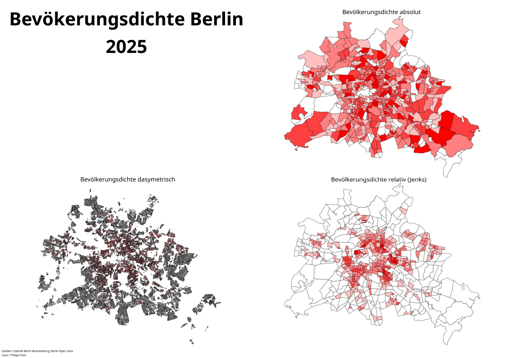
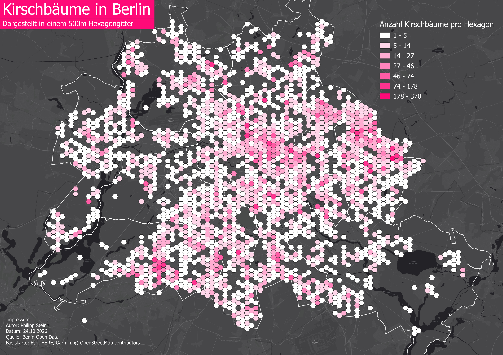
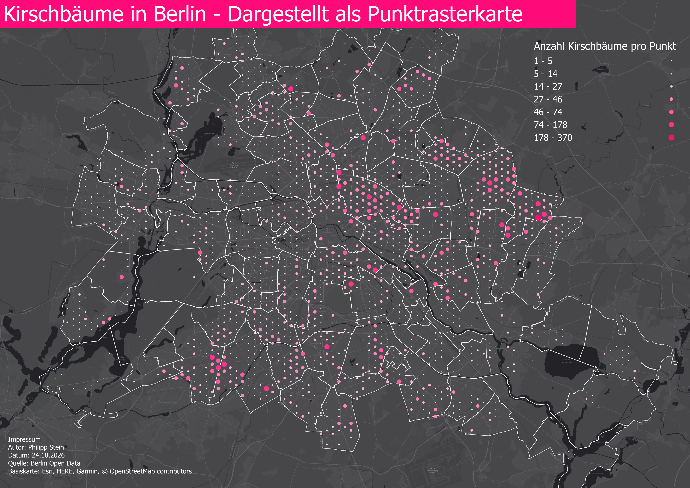
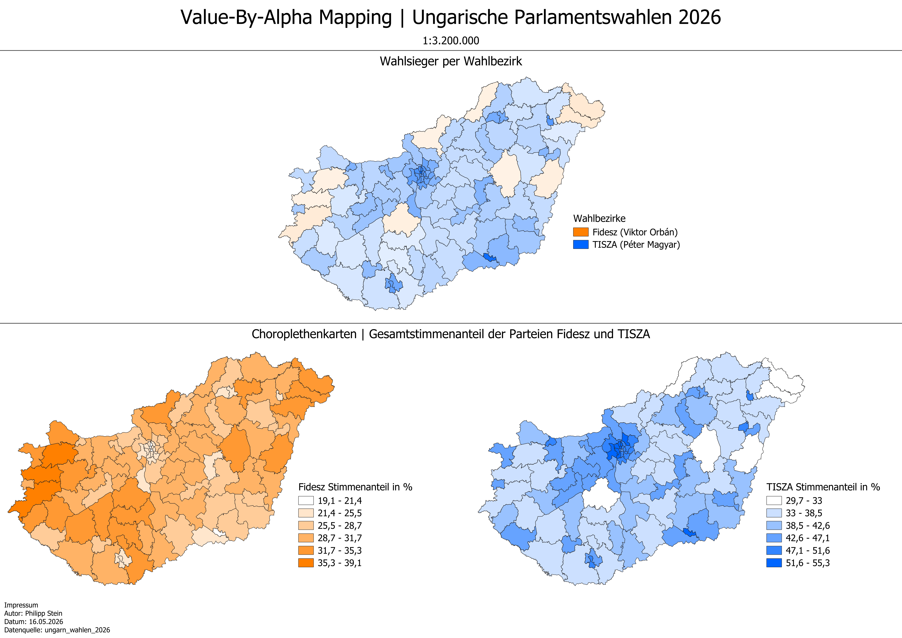
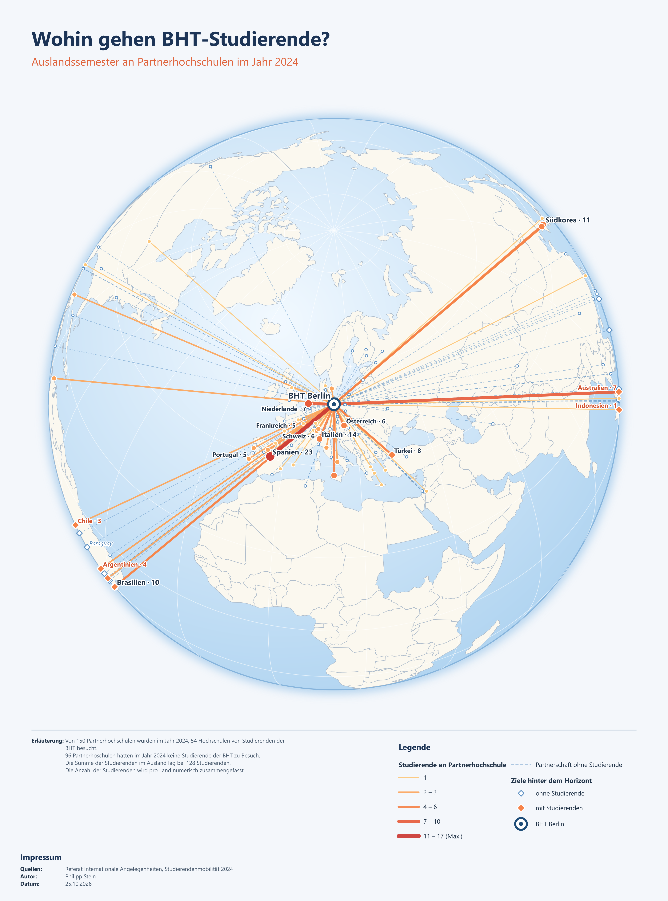
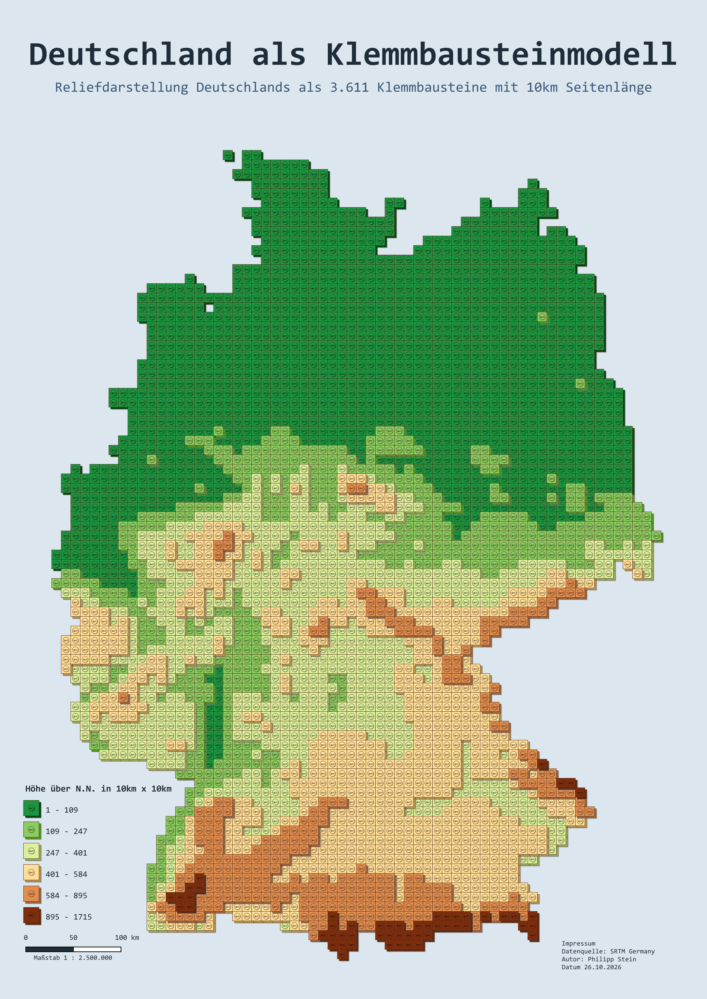
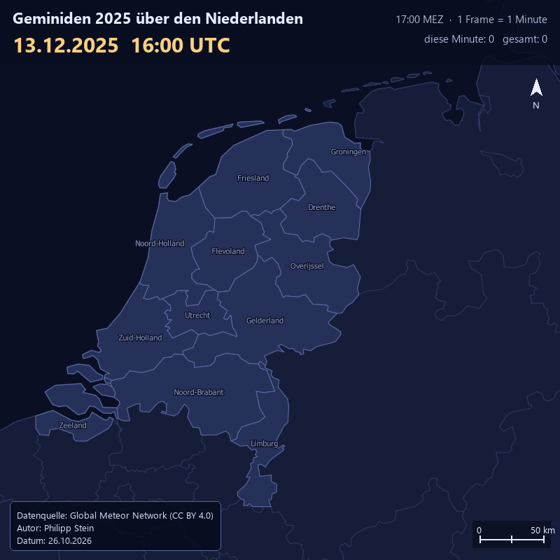
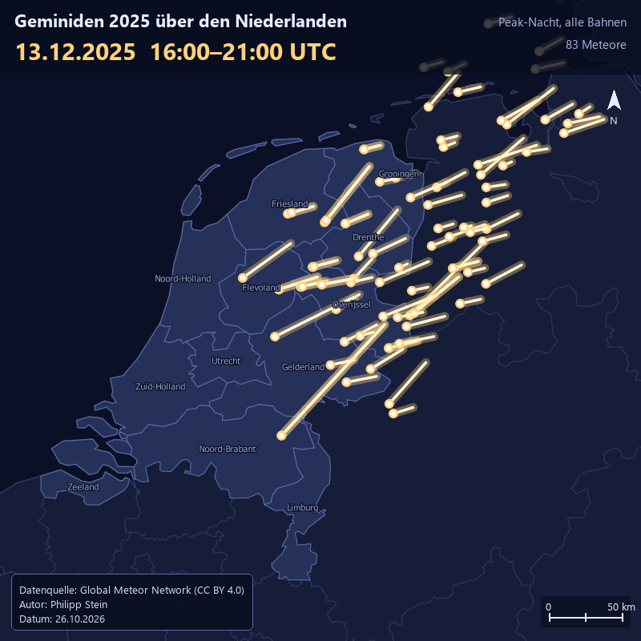
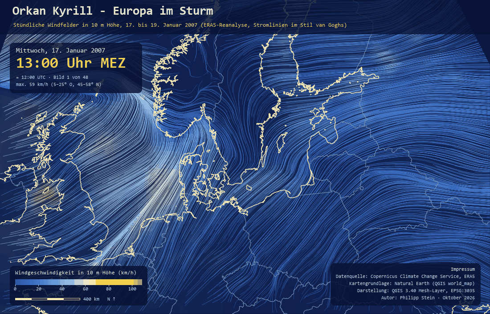
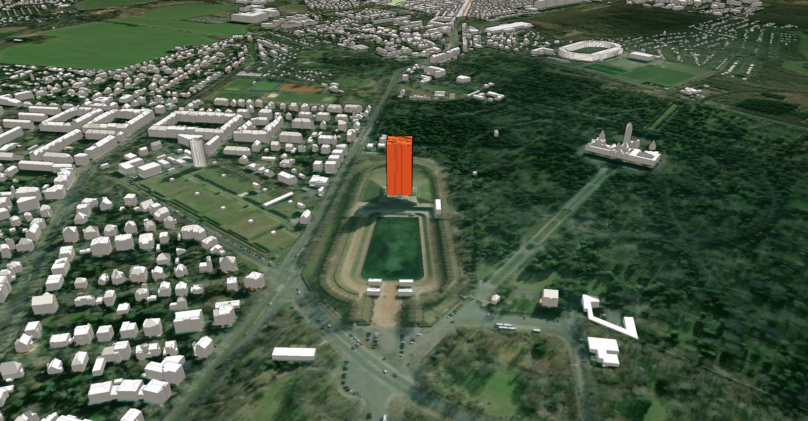

# DTM SoSe 2026

## EP01 | Dasymetrische Choroplethenkarten

In der ersten Aufgabe wurde die Bevölkerungsdichte Berlins im Jahr 2025 mit drei verschiedenen Methoden dargestellt und in einem gemeinsamen Layout gegenübergestellt: als absolute Choroplethenkarte, als relative Choroplethenkarte (Klassifizierung nach Jenks) und als dasymetrische Karte. Die absolute Darstellung zeigt die Einwohnerzahl je Gebiet und lässt große Flächen am Stadtrand dadurch besonders kräftig erscheinen. Die relative Darstellung bezieht die Einwohner auf die Fläche und rückt die dicht besiedelte Innenstadt in den Vordergrund. Die dasymetrische Karte verteilt die Bevölkerung nur auf tatsächlich bewohnte Blockflächen, sodass Wälder, Gewässer und Grünflächen wie der Grunewald oder das Tempelhofer Feld ausgespart bleiben. Der direkte Vergleich zeigt, wie stark die gewählte Methode die Interpretation beeinflusst und dass die dasymetrische Darstellung die reale Siedlungsstruktur am genauesten wiedergibt.

## EP02 | Gitterchoroplethenkarten

Für die zweite Aufgabe wurden die Standorte der Kirschbäume in Berlin (Berlin Open Data) in einem 500-m-Hexagongitter zusammengefasst. Hexagone ohne Kirschbaum wurden entfernt, die übrigen sind entsprechend der Legende nach der Anzahl der Bäume pro Zelle in sieben Pinktönen eingefärbt. Vor dem dunklen Hintergrund werden Hotspots, etwa im Nordosten und Südwesten der Stadt, deutlich sichtbar. Da alle Zellen gleich groß sind, entfällt die Verzerrung durch unterschiedlich große Verwaltungseinheiten und die Werte sind räumlich direkt vergleichbar.

## EP03 | Punktrasterkarten

Die Punktrasterkarte baut auf derselben Datengrundlage und Klassifizierung wie EP02 auf. Statt flächiger Hexagone wird jede Rasterzelle durch einen Punkt in ihrem Mittelpunkt dargestellt, dessen Größe und Farbintensität mit der Anzahl der Kirschbäume zunimmt. Dadurch wirkt die Karte leichter und die Ortsteilgrenzen bleiben als Orientierung sichtbar. Allerdings lassen sich kleine Klassen schwerer voneinander unterscheiden als bei der flächigen Darstellung.

## EP04 | Value-by-Alpha-Mapping

Die Karte zeigt die Ergebnisse der ungarischen Parlamentswahlen 2026 auf Ebene der Wahlbezirke. Zwei Choroplethenkarten bilden zunächst die Stimmenanteile von Fidesz (orange) und TISZA (blau) getrennt ab. Die Value-by-Alpha-Karte kombiniert beide: Die Farbe zeigt den Wahlsieger im Bezirk, die Deckkraft den Vorsprung. Je deutlicher der Sieg, desto kräftiger der Farbton. So wird auf einen Blick erkennbar, dass TISZA vor allem in Budapest und den größeren Städten klar gewinnt, während Fidesz nur in einzelnen ländlichen Bezirken knapp vorne liegt.

## EP05 | Ursprung-Ziel-Karten

Für die Ursprung-Ziel-Karte wurde die Outgoing-Mobilität der BHT im Jahr 2024 auf einer orthographischen Globusprojektion mit Zentrum BHT Berlin dargestellt. Von Berlin führen Großkreisverbindungen zu den 150 Partnerhochschulen. Linienbreite und Farbe geben die Anzahl der Studierenden je Partnerhochschule an, die Länderwerte sind zusätzlich beschriftet (z. B. Spanien 23, Italien 14, Südkorea 11). Partnerschaften ohne Studierende sind gestrichelt, Ziele hinter dem Horizont werden als Rauten am Globusrand markiert. Die Methode macht globale Verflechtungen sehr anschaulich. Bei vielen nahen Zielen in Europa überlagern sich die Linien um den Ursprung jedoch stark, sodass einzelne Verbindungen dort schwer zu unterscheiden sind.

## EP06 | Tilemaps

Die Tilemap zeigt das Relief Deutschlands als Modell aus 3.611 Klemmbausteinen mit je 10 km Seitenlänge (Datengrundlage: SRTM). Jede Kachel ist wie ein Baustein mit Noppen und „BHT“-Aufdruck gestaltet, die Farbe entspricht der mittleren Höhe über N.N. in sechs Klassen von der Norddeutschen Tiefebene bis zu den Alpen. Die starke Generalisierung macht die Großformen des Reliefs sehr intuitiv lesbar, und durch das einheitliche Raster bleiben die Zellen vergleichbar. Feine Strukturen wie einzelne Täler oder Gipfel gehen dabei allerdings verloren, weshalb sich die Methode nicht für präzise Analysen eignet.

## EP07 | Animation in QGIS

In dieser Aufgabe wurde eine zeitbasierte Animation der Geminiden in der Peak-Nacht am 13.12.2025 (16:00–21:00 UTC) über den Niederlanden erstellt. Grundlage sind 83 Meteorbahnen des Global Meteor Network, die als leuchtende Streifen mit Schweif auf einer dunklen Karte erscheinen. Die Animation macht die gemeinsame Flugrichtung und die zeitliche Häufung der Sternschnuppen deutlich intuitiver erfahrbar als eine statische Karte. Nachteile sind der hohe Rechen- und Speicheraufwand sowie die fehlende Gesamtübersicht, da Informationen nur kurz eingeblendet werden.

## EP08 | Mesh-Daten

### Vor- und Nachteile der Methode

Mesh-Daten speichern Werte auf einem Netz aus Knoten und eignen sich deshalb gut für kontinuierliche Größen, die sich räumlich und zeitlich ändern, wie Windfelder. Stromlinien machen die Strömungsrichtung unmittelbar sichtbar, und in der Animation lässt sich verfolgen, wie ein Sturmtief über Europa hinwegzieht und wo der Wind am stärksten ist.

Die dichte, malerische Darstellung geht allerdings auf Kosten der Lesbarkeit: Genaue Windgeschwindigkeiten lassen sich nur grob über die Farbskala abschätzen. Wie bei jeder Animation fehlt außerdem die Gesamtübersicht, und die Datei wird schnell sehr groß.

### Umsetzung der Methode

Grundlage sind die stündlichen Windkomponenten in 10 m Höhe aus der ERA5-Reanalyse des Copernicus Climate Change Service, die als GRIB-Datei in QGIS als Mesh-Layer geladen wurden. QGIS rendert für jede Stunde die Windgeschwindigkeit als Farbfläche und die Stromlinien des Windvektors. Die Stromlinien dienen als Maske für die Farbfläche, sodass nach Geschwindigkeit eingefärbte Pinselstriche auf nachtblauem Grund entstehen, angelehnt an den Stil van Goghs.

## EP09 | 3D-Gebäudemodelle

Grundlage sind die amtlichen LoD2-Gebäudemodelle des Freistaats Sachsen für ein Gebiet rund um das Völkerschlachtdenkmal, und umfassen 2 × 2 km Kacheln. In der 3D-Ansicht von QGIS stehen die Gebäude mit ihren absoluten Dach- und Wandhöhen auf der Kartegrundlage ESRI Satelite Image.
3D-Gebäudemodelle machen Gebäudehöhen, Dachformen und Stadtstrukturen deutlich greifbarer als ein Grundriss. LoD2-Modelle bilden Dächer realistisch ab und eignen sich gut für Stadtbild- und Sichtachsenanalysen, zumal sie für ganze Bundesländer frei verfügbar sind. Der Detailgrad einer 3D Modelliereung ist jedoch begrenzt: Komplexe Bauwerke werden stark vereinfacht, Fassaden und Skulpturen fehlen ganz. Beim Völkerschlachtdenkmal fehlt dadurch jeglicher Detailgrad, es erscheint nur als schlichter Block. Außerdem verdecken hohe Gebäude je nach Blickwinkel andere Objekte, Entfernungen lassen sich in der Schrägansicht nicht messen, und große Modelle brauchen viel Rechenleistung.

